<div align="center">

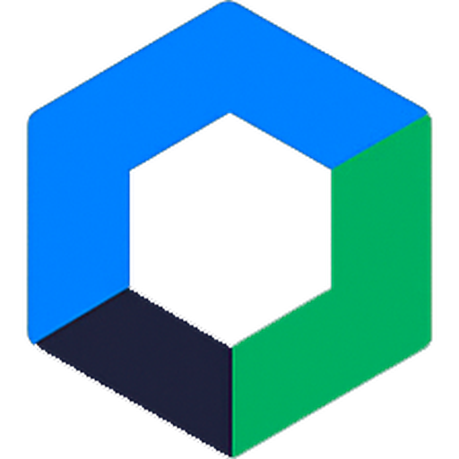

# Figsoft

**Sitio web corporativo de Figsoft, consultora informática de Madrid**<br>
Desarrollo web · Automatización · Inteligencia artificial · Software a medida

[](https://figueira205.github.io/Figsoft/)


</div>

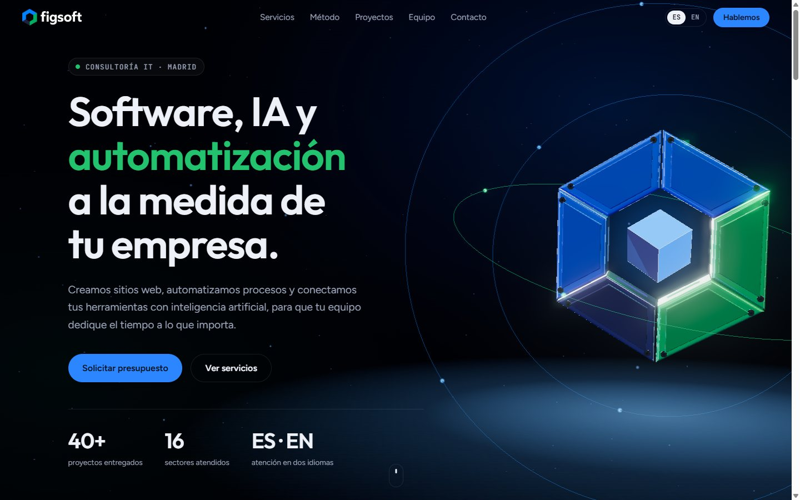

## Índice

1. [Resumen](#resumen)
2. [Recorrido por la página](#recorrido-por-la-página)
3. [Cómo funciona](#cómo-funciona)
4. [Escena 3D](#escena-3d)
5. [Sistema de diseño](#sistema-de-diseño)
6. [Versión móvil](#versión-móvil)
7. [Accesibilidad y rendimiento](#accesibilidad-y-rendimiento)
8. [Estructura del repositorio](#estructura-del-repositorio)
9. [Ejecutar en local](#ejecutar-en-local)
10. [Cómo editar el contenido](#cómo-editar-el-contenido)
11. [Despliegue](#despliegue)
12. [Decisiones de diseño y límites](#decisiones-de-diseño-y-límites)

## Resumen

Una página única que presenta a Figsoft: qué servicios ofrece, cómo trabaja, en qué sectores aplica su trabajo y cómo contactar. Está hecha con HTML, CSS y JavaScript puros, sin compilación ni dependencias que instalar, y se publica tal cual en GitHub Pages.

| Característica | Detalle |
|---|---|
| Escena 3D | El isotipo del logotipo modelado en three.js, con órbitas y bloom, coreografiado sección a sección con el scroll |
| Idiomas | Español e inglés con un botón; recuerda la elección |
| Adaptación | Escritorio, tableta y móvil, con menú propio en pantallas pequeñas |
| Peso | Sin framework; three.js se carga desde una CDN y solo para la escena |
| Respaldo | Si no hay WebGL, la web funciona igual con el fondo en degradado |

## Recorrido por la página

### Portada

Titular que entra línea a línea, descripción, dos llamadas a la acción con efecto magnético y tres cifras que se cuentan al cargar. A la derecha, el isotipo en 3D, que llega por piezas y encaja. Debajo, una banda continua con los 16 sectores atendidos; se detiene al pasar el cursor.

### Servicios

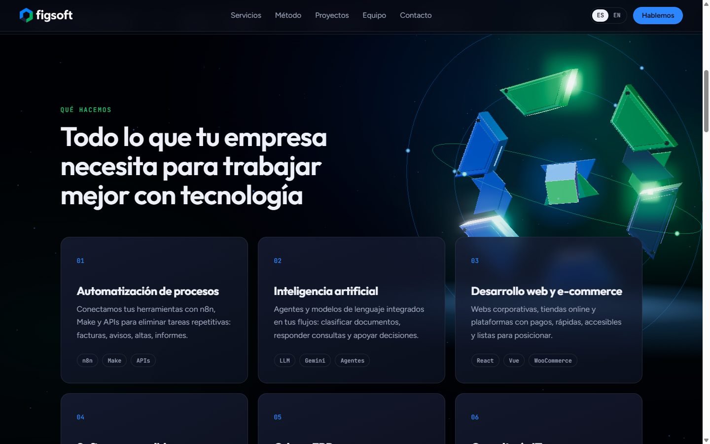

Seis tarjetas: automatización de procesos, inteligencia artificial, desarrollo web y e-commerce, software a medida, Odoo y ERP, y consultoría IT. Cada una lleva etiquetas con las herramientas implicadas. Con ratón, la tarjeta se inclina en 3D y un foco de luz sigue al cursor.

### Método

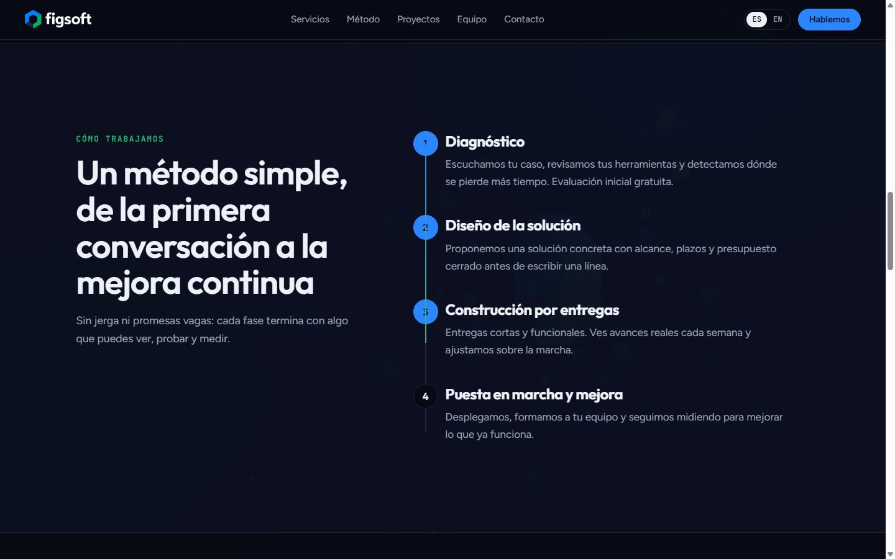

Cuatro fases: diagnóstico, diseño de la solución, construcción por entregas y puesta en marcha. La línea vertical se rellena según avanzas y cada número se enciende al llegar a su fase. El titular queda fijo mientras se recorren los pasos.

### Casos de uso

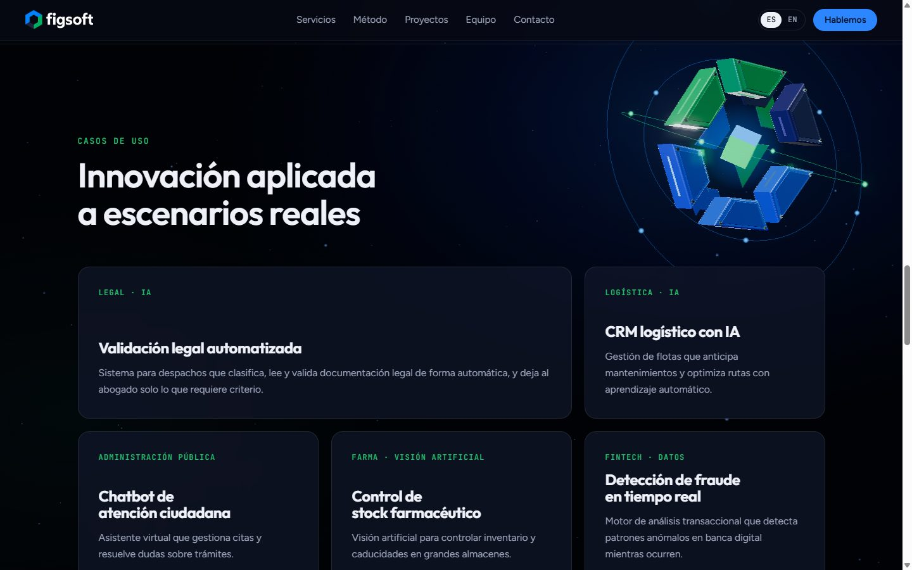

Cinco escenarios de aplicación: validación legal automatizada, CRM logístico con IA, atención ciudadana, control de stock farmacéutico y detección de fraude. Son ejemplos del tipo de trabajo, no proyectos con cliente nombrado.

### Tecnología y equipo

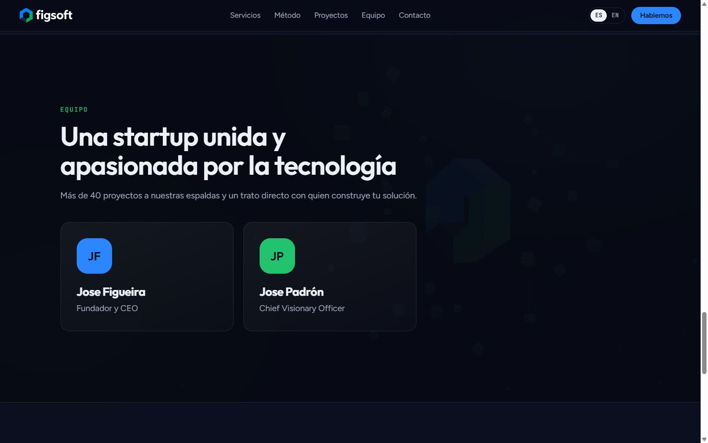

Una nube de etiquetas con las herramientas que se usan en los proyectos (n8n, Make, Odoo, Python, TypeScript, React, Vue, Angular, Node.js, PostgreSQL, Docker, Gemini API, WooCommerce, Supabase, Stripe, RabbitMQ, Django y Unity) y las tarjetas del equipo.

### Contacto

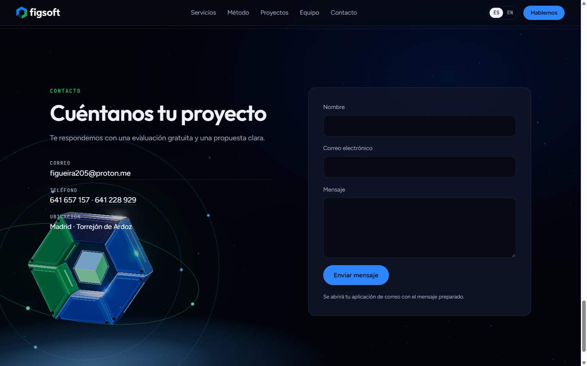

Correo, teléfonos y ubicación, más un formulario. Al enviarlo se validan los campos y se abre la aplicación de correo con el mensaje ya redactado, porque la web no tiene servidor.

### Versión en inglés

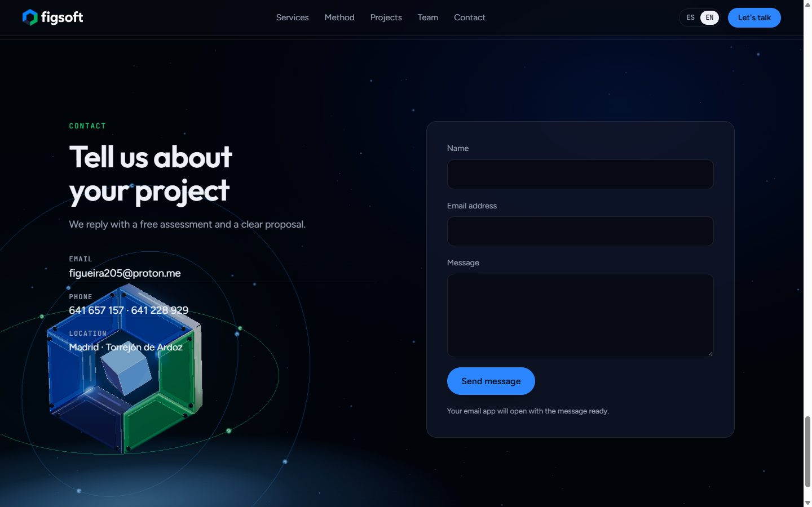

El botón **ES / EN** del menú cambia todos los textos sin recargar la página.

## Cómo funciona

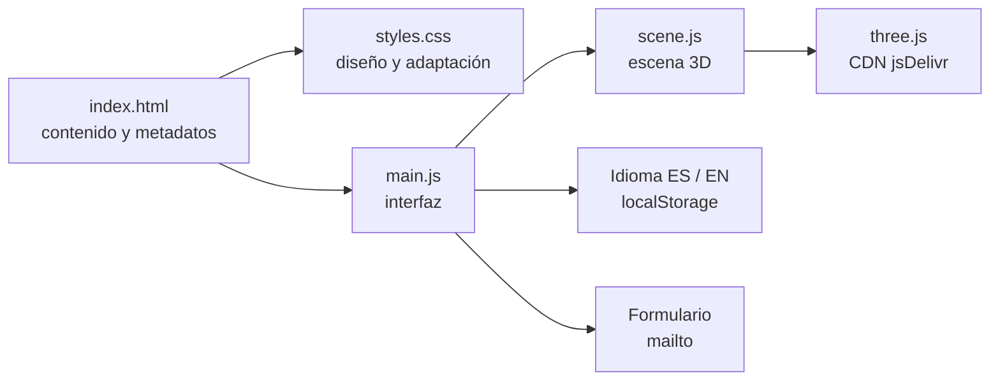

1. **`index.html`** contiene todo el texto en español. Cada elemento traducible lleva un atributo `data-i18n` con su clave.
2. **`main.js`** se carga como módulo. Al arrancar lee los textos en español del propio HTML, guarda el diccionario inglés y alterna entre ambos. Después activa la barra de navegación, el menú móvil, las animaciones de entrada y los efectos del cursor.
3. **`scene.js`** se importa dinámicamente y dentro de un `try/catch`. Si el navegador no tiene WebGL, o la CDN no responde, solo se omite la escena.
4. **`styles.css`** define los colores como variables y todos los componentes.

### Piezas de interfaz

| Pieza | Cómo está resuelta |
|---|---|
| Titular por líneas | Cada línea es un `span` con `overflow: hidden`; el texto interior sube con una transición al añadir la clase `is-in` |
| Entrada al hacer scroll | `IntersectionObserver` añade `is-in` a cada bloque. La clase `js` solo se pone desde JavaScript, así que sin JS todo queda visible |
| Contadores | Interpolación con curva de salida durante 1,6 s |
| Barra de navegación | Un centinela de 60 px en lo alto detecta el scroll y activa el fondo de cristal |
| Línea del método | La variable CSS `--p` (0 a 1) escala la barra según la posición en pantalla |
| Botones magnéticos | Calculan el desplazamiento del cursor respecto al centro y lo aplican con variables CSS |
| Tarjetas inclinadas | Las variables `--rx` y `--ry` rotan la tarjeta; `--mx` y `--my` colocan el foco de luz |
| Formulario | Valida nombre, correo y mensaje, y construye un enlace `mailto:` con el contenido |

## Escena 3D

El isotipo no es una imagen: se modela en código como un objeto físico, pieza a pieza, y se anima con una coreografía ligada al scroll.

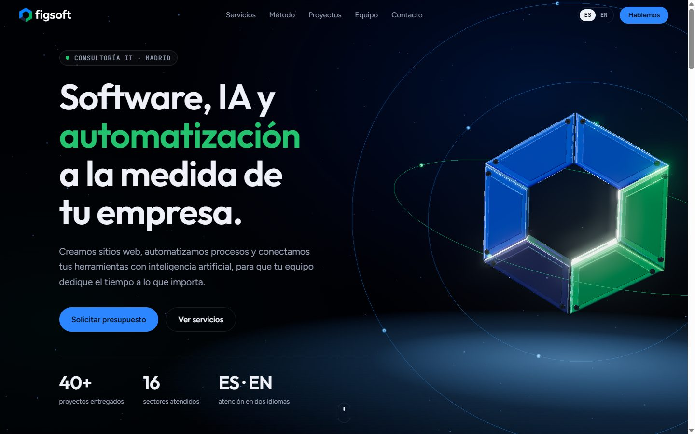

### El modelo

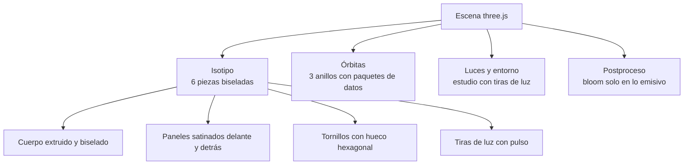

| Elemento | Detalle |
|---|---|
| Piezas | Seis trapecios extruidos, uno por lado del hexágono, con color del logotipo (azul, verde y azul marino). Cada una tiene bisel redondeado de 7 segmentos y una holgura mínima con sus vecinas, como piezas ensambladas |
| Materiales | Barniz de coche: capa transparente (`clearcoat`) sobre pintura ligeramente metálica. Los paneles incrustados son satinados, para que el contraste brillo / mate dibuje la forma |
| Detalle | Paneles incrustados delante y detrás, dos tornillos por pieza con hueco hexagonal y tiras de luz en las caras exterior e interior |
| Pulso de datos | Una onda de luz recorre las seis tiras, una pieza tras otra, como una señal que da la vuelta al anillo |
| Órbitas | Tres anillos inclinados con paquetes de luz que los recorren a distinta velocidad |
| Entorno | Un estudio generado en código con tiras de luz blancas, azules y verdes que se reflejan con nitidez en el barniz |
| Postproceso | `UnrealBloomPass` con umbral alto: solo brillan las tiras y los paquetes, no las superficies |
| Suelo | Un disco de luz bajo el objeto lo asienta en la escena |

### Coreografía con el scroll

El objeto no gira sin rumbo: cada sección tiene una **pose** (posición, escala, rotación, apertura y órbitas) y el scroll interpola entre una y la siguiente con una curva suave. La pose actual persigue a la pose objetivo con amortiguación, así que el movimiento nunca es brusco.

| Sección | Qué hace el objeto |
|---|---|
| Portada | Las seis piezas llegan una a una, girando desde su lado, y encajan con un leve rebote y un destello en la tira de luz. El centro queda vacío, como en el logotipo. Reacciona al ratón con una inclinación contenida |
| Servicios | Se **abre**: las piezas se separan en su dirección radial y se escalonan en profundidad, como una escalera |
| Método | Pasa a la **izquierda**, bajo el titular, y gira 60° con cada una de las cuatro fases, sincronizado con la línea de progreso. Cada paso lo mueve un muelle que asienta con un pequeño rebote. Al terminar completa la vuelta |
| Casos de uso | Se recoge junto al titular y las órbitas toman protagonismo |
| Tecnología y equipo | Vuelve a la derecha, ensamblado y más pequeño |
| Contacto | Regresa a la izquierda y se cierra frente a la cámara |

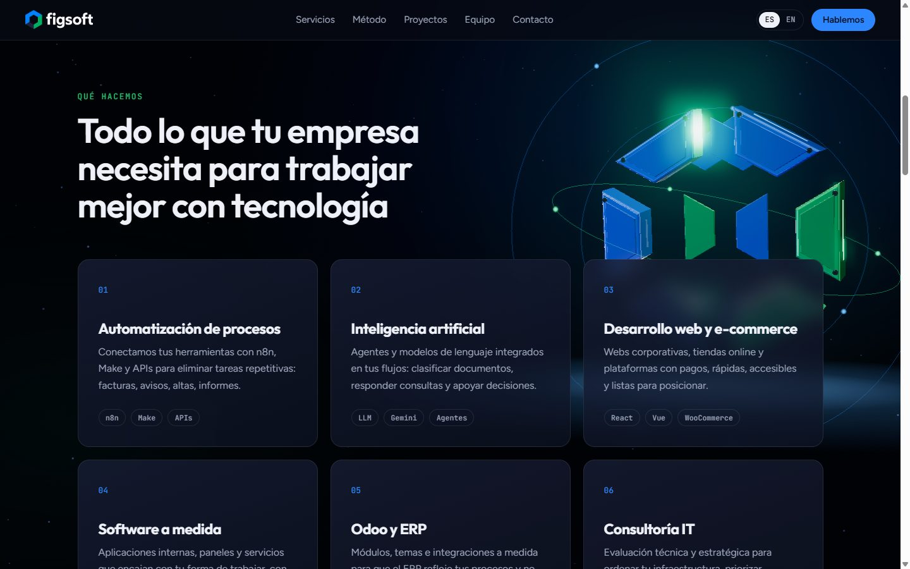

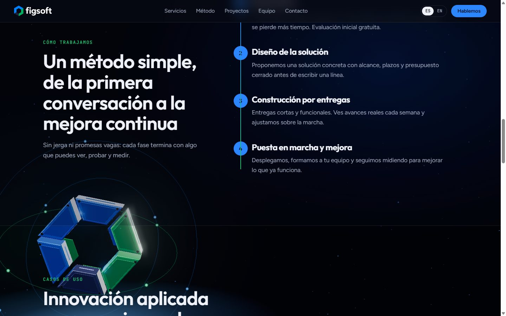

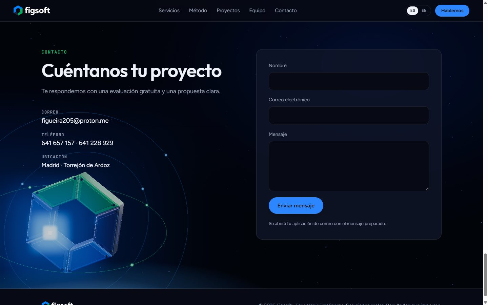

Cuando el objeto cruza la pantalla de un lado al otro se atenúa un 55 %, para no tapar el texto que atraviesa.

### Rendimiento y respaldo

| Aspecto | Solución |
|---|---|
| Resolución | Limitada a 1,75x en escritorio y 1,5x en móvil |
| Pestaña oculta | El bucle de dibujo se detiene |
| Móvil | Objeto centrado arriba, más pequeño y atenuado para mantener la lectura; menos partículas |
| Movimiento reducido | Se dibuja un fotograma por cada cambio de scroll, sin bucle, sin entrada animada y con la pose exacta de cada sección |
| Sin WebGL o sin CDN | La escena se omite y la página funciona con el fondo en degradado |

## Sistema de diseño

Los colores salen del logotipo. Una sola marca, dos acentos y fondos azul marino muy oscuros.

| Token | Valor | Uso |
|---|---|---|
| `--blue` | `#2b86ff` | Acento principal, botones y foco |
| `--green` | `#22c26e` | Acento secundario, etiquetas y estados |
| `--navy` | `#24263c` | Tono del logotipo, usado en la escena 3D |
| `--bg` | `#070a14` | Fondo de la página |
| `--surface` | `#101528` | Tarjetas y formulario |
| `--muted` | `#9aa3b8` | Texto secundario |

**Tipografías:** Outfit para titulares (su geometría recuerda a la del logotipo), Figtree para el texto y JetBrains Mono para etiquetas y datos.

**Reglas aplicadas:** un solo acento por componente, radios de 18 px en superficies y píldoras en controles, sombras neutras (sin brillos de color), foco visible y texto con contraste suficiente sobre el fondo oscuro.

## Versión móvil

<p>
  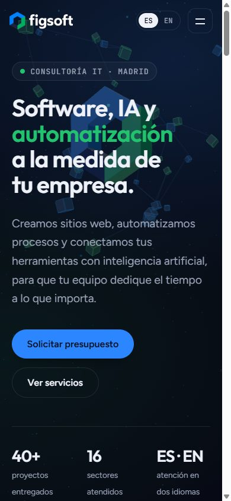
  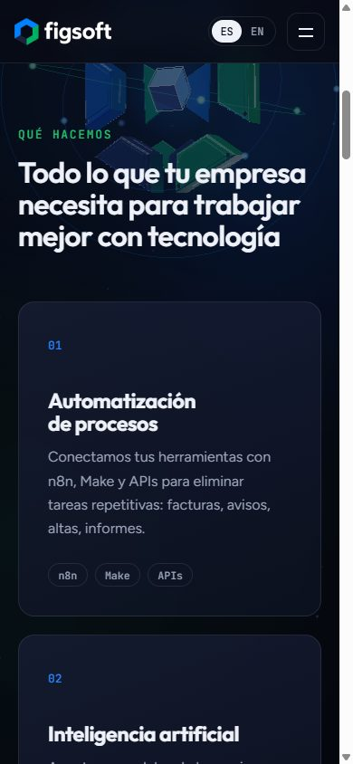
  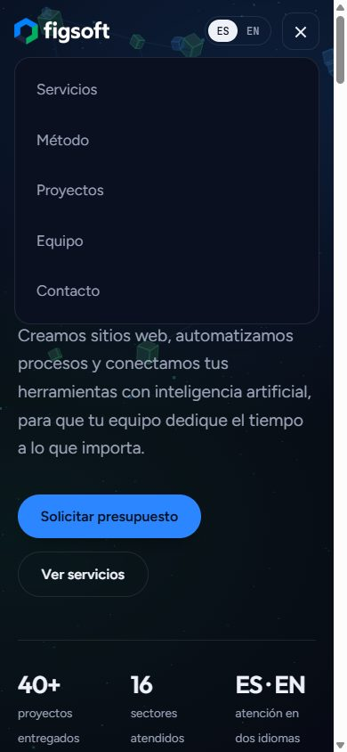
</p>

Por debajo de 760 px las columnas pasan a una y el menú se convierte en un panel desplegable opaco. El isotipo se coloca arriba, centrado y atenuado, y el botón de contacto se retira de la barra porque ya está en el menú y en la portada.

## Accesibilidad y rendimiento

- Enlace de salto al contenido y foco visible en todos los controles.
- El menú móvil usa `aria-expanded`, `aria-controls` y se cierra con `Escape`.
- La escena 3D es decorativa (`aria-hidden`) y no captura el puntero.
- Con `prefers-reduced-motion` se desactivan transiciones, la banda de sectores y el bucle 3D.
- El idioma actualiza el atributo `lang` del documento.
- Resolución del lienzo limitada y bucle detenido con la pestaña en segundo plano.
- Metadatos Open Graph y datos estructurados `ProfessionalService` para buscadores y vistas previas.

## Estructura del repositorio

```text
Figsoft/
├── index.html          Contenido, metadatos y datos estructurados
├── styles.css          Variables de color, componentes y adaptación
├── main.js             Interfaz, idioma y formulario
├── scene.js            Escena 3D con three.js
├── assets/
│   ├── logo.webp       Logotipo para fondo oscuro
│   ├── logo-dark.webp  Logotipo para fondo claro
│   ├── mark.png        Isotipo
│   ├── favicon.png     Icono de pestaña
│   └── apple-touch-icon.png
└── docs/               Capturas de este README
```

## Ejecutar en local

```bash
git clone https://github.com/Figueira205/Figsoft.git
cd Figsoft
python -m http.server 8000
```

Abre http://localhost:8000. Hay que servirlo por HTTP: los módulos de JavaScript no cargan desde `file://`. Cualquier servidor estático sirve (`npx serve`, la extensión Live Server de VS Code, etc.).

## Cómo editar el contenido

| Quiero... | Dónde |
|---|---|
| Cambiar un texto | En `index.html`, el texto en español. El inglés está en el objeto `EN` de `main.js`, con la misma clave `data-i18n` |
| Añadir un servicio | Duplica un `<article class="card">` en `index.html`, cambia su número y claves, y añade las dos traducciones |
| Añadir una herramienta | Añádela al array `STACK` de `main.js` |
| Cambiar la lista de sectores | Objeto `SECTORS` de `main.js`, en español e inglés |
| Cambiar los colores | Variables de `:root` en `styles.css`; los colores de la escena están al principio de `scene.js` |
| Cambiar los datos de contacto | Sección `#contacto` de `index.html` y la dirección del `mailto:` en `main.js` |
| Añadir un idioma | Crea un diccionario como `EN`, añade su lista de sectores y amplía el botón de idioma |

## Despliegue

La web se publica con **GitHub Pages** desde la rama `main`, carpeta raíz. Cada `git push` a `main` la actualiza en uno o dos minutos. No hay paso de compilación.

## Decisiones de diseño y límites

- **Sin chatbot.** La versión anterior incluía un asistente con la API de Gemini que necesitaba la clave en el navegador, donde cualquier visitante podía leerla. Con una web estática no hay forma segura de guardarla. Para recuperarlo haría falta un pequeño servidor o un flujo en n8n que haga de intermediario.
- **Sin noticias.** La sección anterior usaba imágenes de relleno y no tenía contenido detrás.
- **Formulario por correo.** Sin servidor, el formulario abre el cliente de correo del visitante. Para recibir mensajes sin esa acción habría que conectar un servicio de formularios.
- **Casos de uso genéricos.** Describen el tipo de solución, no clientes concretos.
- **Dependencia de una CDN.** three.js 0.170 y sus módulos de postprocesado se cargan desde jsDelivr con versión fija (`importmap` de `index.html`). Si se quiere independencia total, se pueden copiar a `assets/` y cambiar las rutas del `importmap`.

## Historia

La versión anterior era un proyecto Angular sin compilar, por lo que GitHub Pages mostraba una página en blanco. Esta versión la sustituye por una web estática con la identidad visual del logotipo.
